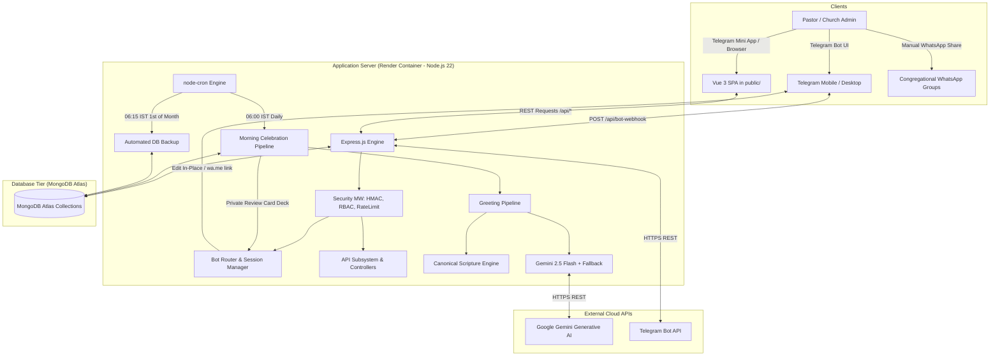
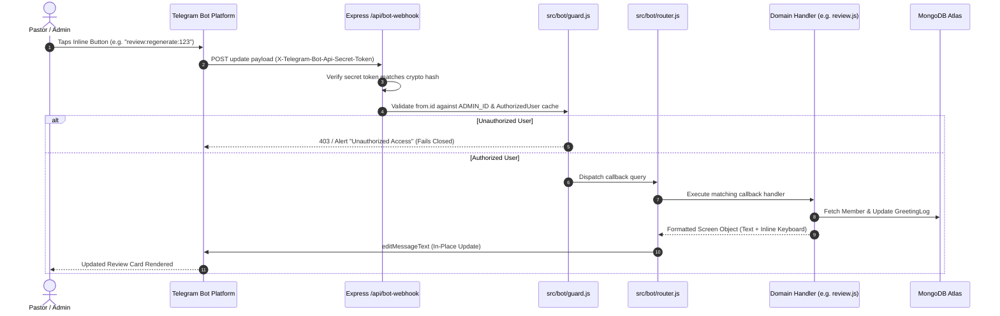
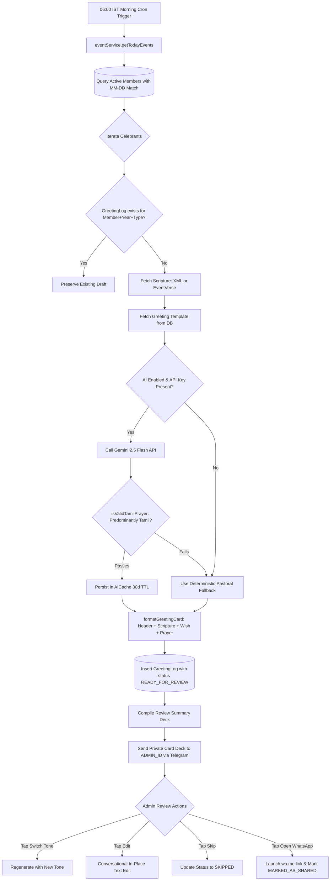
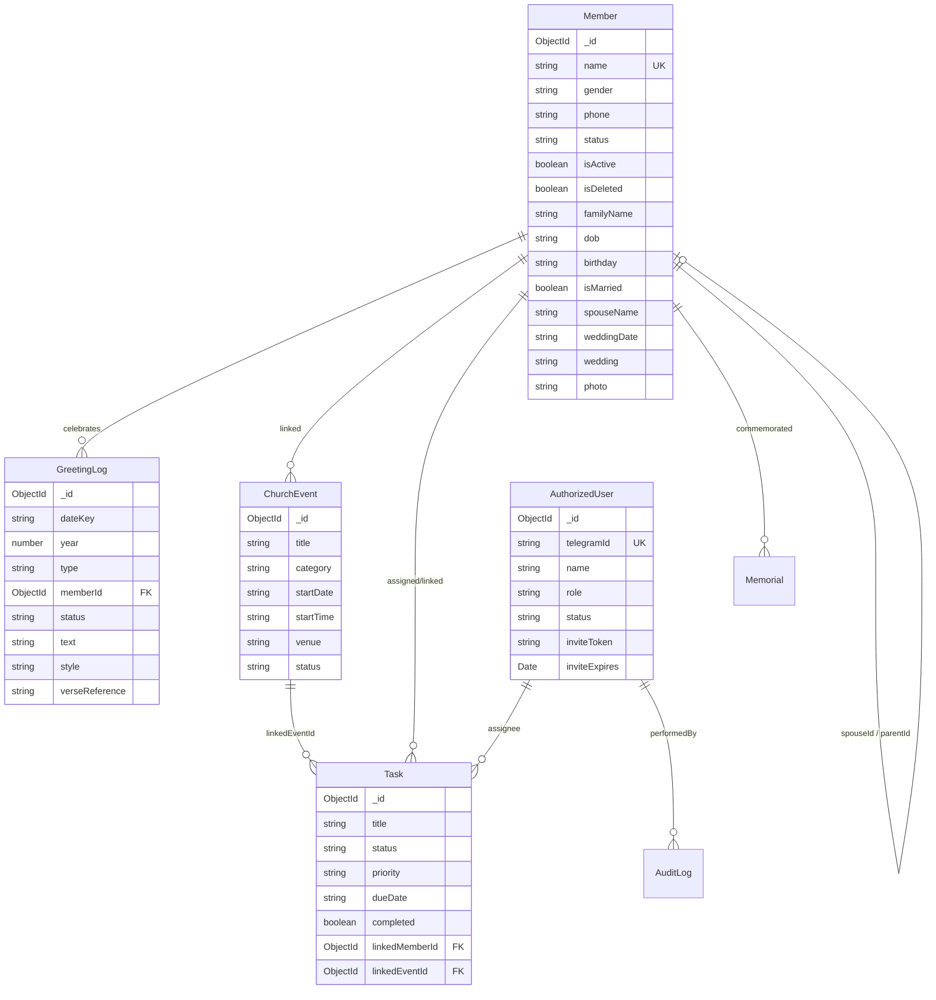

# SPBC Church CMS & Telegram Bot — Repository Audit & Technical Intelligence Report

> **Target Repository:** `salempbc/whatsapp-chatbot`  
> **Repository Version:** 2.1.0 (`package.json`)  
> **Audit Date:** October 20, 2026  
> **Auditor Role:** Senior Software Architect, Full-Stack Engineer, AppSec Auditor, QA & DevOps Engineer  
> **Audit Status:** Complete (Read-Only Discovery, Zero Modification)  
> **Output Document:** `docs/SPBC_REPOSITORY_AUDIT.md`

---

## Executive Summary

### 1. What the Application Actually Does
The application is a specialized church administration platform engineered for **Salem Primitive Baptist Church (SPBC)** (*சேலம் ஆதி பாப்திஸ்து திருச்சபை*), a Tamil-speaking Christian congregation. It serves as an administrative operations hub that:
1. **Tracks Congregational Life Milestones:** Monitors member birthdays, wedding anniversaries, and family death memorial dates.
2. **Generates Daily Celebration Greetings:** At 06:00 AM IST daily, drafts culturally contextualized Christian greetings combining canonical verses from the **Tamil Bible Old Version (BSI - பரிசுத்த வேதாகமம் O.V.)** and pastoral prayer blessings drafted by Google Gemini AI (or deterministic offline fallbacks).
3. **Facilitates WhatsApp Broadcasts:** Delivers a private review card deck to the church pastor/administrator on Telegram (`/review`), allowing them to inspect, regenerate, re-tone, or edit the greeting text before copying or launching pre-filled WhatsApp links (`https://wa.me/`) for group or private messaging.
4. **Produces Weekly Church Bulletins:** Compiles weekly meditation verses, Sunday/mid-week service schedules, upcoming church calendar events, and member milestones into WhatsApp-formatted broadcasts (`/bulletin`).
5. **Maintains Congregational Directory & Tasks:** Provides a Telegram conversational bot and an embedded Vue 3 Telegram Mini App (TMA) to manage members, households, pastoral tasks, event scheduling, iCalendar feeds, CSV exports, and demographic reports.

### 2. Verified Runtime Architecture
- **Process Model:** A single-process Node.js (v22) service hosting an Express HTTP server, an encrypted Telegram Bot webhook/polling engine (`node-telegram-bot-api`), an in-memory `node-cron` task scheduler, and a static file server hosting the Vue 3 Single Page Application (SPA).
- **Persistence:** MongoDB Atlas via Mongoose ODM, utilizing compound indexes for anniversary queries, task lifecycles, and greeting idempotency.
- **Hosting Target:** Cloud container/PaaS on Render (`https://spbc-bot.onrender.com`), protected by a reverse proxy trust configuration (`trust proxy: 1`), Helmet CSP, and Express rate limiting.

### 3. Strongest Aspects of the Implementation
1. **Strict Canonical Scripture Guardrails:** Scripture verses are never generated by AI. They are loaded directly from a local canonical XML database (`public/Tamil Bible.xml`) or curated MongoDB `EventVerse` collections.
2. **Privacy-Preserving Greeting Delivery:** Scheduled jobs never blast public WhatsApp or Telegram groups. All output is strictly routed to the authorized `ADMIN_ID` for human-in-the-loop validation.
3. **Greeting Idempotency:** The `GreetingLog` collection uses a compound unique index `{ dateKey: 1, year: 1, memberId: 1, type: 1 }`, preventing duplicate greeting drafts across server restarts.
4. **Resilient AI Fallback & Quality Gate:** If the Google Gemini API fails or is rate-limited, the system falls back to rich, age-specific Tamil Christian pastoral blessings. The `isValidTamilPrayer` function strictly rejects English planning tokens or prompt leaks.
5. **Comprehensive Automated Test Suite:** 57 automated unit and integration tests passing in `4.2s` (`node --test`), verifying HMAC validation, Tamil Bible XML lookups, TaskFlow parsers, and status state machines.

### 4. Most Critical Risks
1. **Critical Authentication Bypass (Hardcoded Admin ID Fallback):** In `public/app.js` (lines 424, 467-468), the hardcoded string `'7018241155'` is stored as the default authentication token in `localStorage`/`sessionStorage`. Combined with `src/api/middleware.js` (lines 44-54), which treats `process.env.ADMIN_ID` as a valid bearer token granting `role: "superadmin"`, any web visitor to `https://spbc-bot.onrender.com` automatically gains full unauthenticated administrative access.
2. **Missing Granular Authorization Checks on Core REST Endpoints:** Routes such as `GET/POST /api/members`, `POST /api/members/:id/archive`, `GET /api/export`, and `POST /api/settings` do not invoke `requirePermission(...)`. Any authenticated user (including staff or volunteers) can modify settings or export the entire member roster.
3. **Lack of Automated Database Restore Procedures:** While automated database dumping to gzipped JSON is implemented (`src/services/backupService.js`), there is zero automated or tested database restoration code in the repository.
4. **Unescaped Regular Expression in Member Search:** In `src/bot/handlers/bible.js` (line 214), search input for `/genwish <name>` is passed unescaped into `new RegExp(searchName, "i")`, leaving the bot vulnerable to regex syntax crashes or ReDoS.
5. **Memory and Size Constraints with Base64 Task Attachments:** In `src/models/Task.js` (line 24), attachments are stored as raw Base64 strings directly in MongoDB documents, threatening the 16MB BSON limit and process memory.

### 5. Top 10 Recommended Improvements
1. **Remediate WebApp Hardcoded Credential Bypass:** Remove lines 424 and 467-468 from `public/app.js` and eliminate the `ADMIN_ID` bearer token bypass in `src/api/middleware.js`. Enforce cryptographically random `ADMIN_SECRET` or valid Telegram `initData` HMAC.
2. **Enforce Consistent RBAC on All REST Endpoints:** Apply `requirePermission("canManageMembers")`, `requirePermission("canExportData")`, and `requirePermission("canManageTemplates")` to their corresponding Express routes.
3. **Implement Tested Database Restore Tooling:** Author `scripts/restore_backup.js` to parse and safely restore `.json.gz` dumps produced by `backupService.js`.
4. **Escape Regex Inputs Across All Handlers:** Wrap all dynamic search inputs (especially `/genwish` in `bible.js`) with an `escapeRegex` utility.
5. **Year-End Calendar Wrap Sorting Fix:** Replace lexical `localeCompare(a.mmdd, b.mmdd)` in `eventService.js` with date-offset arithmetic so December searches spanning into January sort chronologically.
6. **Move Task Attachments Out of MongoDB BSON:** Migrate task attachments from raw Base64 in MongoDB to object storage (e.g. S3/Cloudflare R2) or store files on disk with metadata references.
7. **Address Duplicate Member Name Constraint:** Relax `unique: true` on `Member.name` or transition to compound unique indexing (e.g., `name` + `familyName` + `dob`) to support members sharing common names.
8. **Automate Webhook Setup on Boot:** Add automatic webhook registration during `initTelegram()` in production to eliminate manual cURL setup.
9. **Implement Distributed Lock for Background Cron:** Introduce MongoDB-backed distributed leasing for scheduled jobs to prevent concurrent execution if horizontally scaled.
10. **Refactor Monolithic `public/app.js`:** Modularize the 2,614-line frontend Vue script into cohesive ES modules or SFCs.

### 6. Major Uncertainties and Limitations of the Audit
- **Live Database State:** The audit was conducted using local code and repository inspection; the live production database contents, existing user records, and cloud environment secrets on Render were not directly queried.
- **Visual UX Verification:** Inspection of the Vue 3 frontend was conducted via static source analysis of `public/app.js` and `public/index.html`. No interactive browser session or live Telegram WebApp UI rendering was recorded.
- **External Network Dependencies:** Third-party uptime pingers (e.g., cron-job.org) and Render auto-sleep schedules could not be observed from repository code alone.

---

## Section 1: Repository Inventory

### 1.1 Root Directory & Configurations
- `package.json` / `package-lock.json`: Project manifest defining Node.js ES modules (`"type": "module"`), Node 22 runtime target, and production dependencies.
- `render.yaml`: Infrastructure-as-Code Blueprint defining the Render web service (`spbc-church-cms-staging`), Oregon region, Node runtime, health check path `/ping`, and environment mappings.
- `.env.example`: Template for environment variables documenting required secrets (`MONGO_URI`, `BOT_TOKEN`, `ADMIN_ID`, `ADMIN_SECRET`, `WEBAPP_URL`, `GEMINI_API_KEY`).
- `.gitignore`: Configured to exclude `node_modules`, `session`, `.env`, `backups/`, `*.gz`, and `*.pdf`.

### 1.2 Application Source Code (`src/`)
- `src/app.js`: Master application entry point. Configures Express middleware, security headers, rate limiting, routing, MongoDB lifecycle hooks, graceful shutdown, and uncaught exception handling.
- `src/config/`:
  - `db.js`: Mongoose connection manager with reconnection events and error logging.
  - `logger.js`: Centralized logging utility.
- `src/api/`:
  - `index.js`: Primary Express API router containing 50+ endpoints for members, events, tasks, templates, greetings, reports, users, diagnostics, and error logs.
  - `middleware.js`: Security and authentication middleware implementing Telegram WebApp `initData` HMAC-SHA256 validation, standalone secret token comparison, and granular RBAC checks.
- `src/bot/`:
  - `index.js`: Telegram bot lifecycle manager, webhook/polling selector, and outgoing message rate-limiting queue.
  - `guard.js`: Fail-closed security guard enforcing admin authorization for Telegram commands and callbacks.
  - `router.js`: Hierarchical callback query dispatcher and conversational state machine router.
  - `session.js`: In-memory conversational state manager for multi-step input wizards.
  - `ui.js`: Presentation helper generating standard inline keyboards and editing bot messages in-place.
  - `handlers/`: Modular bot controllers (`bible.js`, `bulletin.js`, `calendar.js`, `events.js`, `export.js`, `home.js`, `members.js`, `memorial.js`, `review.js`, `settings.js`, `stats.js`, `tasks.js`, `templates.js`, `upcoming.js`, `users.js`).
- `src/models/`:
  - Mongoose data models: `Member.js`, `ChurchEvent.js`, `Task.js`, `GreetingLog.js`, `Template.js`, `Memorial.js`, `EventVerse.js`, `Bible.js`, `AuthorizedUser.js`, `AuditLog.js`, `ErrorLog.js`, `aiCache.js`, `Settings.js`, `Meta.js`.
- `src/scheduler/`:
  - `dailyJob.js`: `node-cron` scheduler running the 06:00 AM IST morning greeting job, 20:00 PM IST eve-reminder job, and 1st-of-month 06:15 AM IST backup job.
- `src/services/`:
  - Domain business logic services: `aiService.js`, `backupService.js`, `bulletinService.js`, `churchCalendarService.js`, `errorLogService.js`, `eventService.js`, `exportService.js`, `greetingService.js`, `memberService.js`, `reportService.js`, `tamilBibleService.js`, `taskService.js`, `userService.js`.

### 1.3 Client Assets (`public/`)
- `index.html`: Single-page application HTML shell with Tailwind CSS layout, responsive tabs, modals, and Tamil typography.
- `app.js`: Monolithic client-side Vue 3 application (2,614 lines) managing state, API communication, dark mode, filtering, search, and form modals.
- `Tamil Bible.xml`: 4.8MB XML database containing the complete canonical text of the Tamil Bible Old Version (BSI).
- `vue.global.js`, `tailwind.js`, `manifest.json`, `sw.js`: Frontend libraries and Progressive Web App service worker assets.

### 1.4 Operational Scripts & Documentation
- `scripts/run_backup.js`: Standalone CLI script invoked by GitHub Actions to generate gzipped database dumps without external database tools.
- `tools/scan-encoding.cjs`, `tools/verify-vue-keys.cjs`: Code quality utilities checking for UTF-8 mojibake, BOM markers, and Vue template key parity.
- `.github/workflows/`:
  - `backup.yml`: Weekly scheduled workflow exporting and storing database backups as GitHub Actions artifacts.
  - `ci.yml`: Continuous integration pipeline executing test suites on push and PR.
  - `codeql.yml`: GitHub CodeQL security analysis pipeline.
- `docs/`: Architectural documentation, deployment runbooks, and staging guides.

---

## Section 2: Architecture and Data-Flow Diagrams

### 2.1 System Context Architecture



### 2.2 Telegram Command and Callback Request Flow



### 2.3 Authentication and Authorization Architecture

```mermaid
flowchart TD
    Request[Incoming HTTP Request] --> AuthHeaderCheck{Authorization Header Present?}
    
    AuthHeaderCheck -- No --> QueryAuthCheck{Query ?auth= Present?}
    QueryAuthCheck -- No --> Reject401[Reject 401 Unauthorized]
    
    AuthHeaderCheck -- Yes --> ExtractToken[Extract Bearer Token / initData]
    QueryAuthCheck -- Yes --> ExtractToken
    
    ExtractToken --> CheckAdminSecret{Matches process.env.ADMIN_SECRET?}
    CheckAdminSecret -- Yes --> GrantSuperAdmin[Assign req.user = superadmin]
    
    CheckAdminSecret -- No --> CheckAdminIdPasscode{Matches process.env.ADMIN_ID?}
    CheckAdminIdPasscode -- Yes --> GrantSuperAdminPasscode[Assign req.user = superadmin (RISK)]
    
    CheckAdminIdPasscode -- No --> ParseInitData[Parse Telegram WebApp initData]
    ParseInitData --> VerifyHMAC{HMAC-SHA256 Valid against BOT_TOKEN?}
    VerifyHMAC -- No --> Reject403Sig[Reject 403 Invalid Signature]
    
    VerifyHMAC -- Yes --> CheckFreshness{auth_date within 24 Hours?}
    CheckFreshness -- No --> Reject403Exp[Reject 403 Session Expired]
    
    CheckFreshness -- Yes --> CheckRBAC{User ID in ADMIN_ID or AuthorizedUser Cache?}
    CheckRBAC -- No --> Reject403RBAC[Reject 403 Not Authorized]
    
    CheckRBAC -- Yes --> ResolvePermissions[Resolve User Role & Granular Permissions]
    ResolvePermissions --> RoutePermissionCheck{Route requires specific permission?}
    RoutePermissionCheck -- No --> PassRoute[Pass to Controller]
    RoutePermissionCheck -- Yes --> CheckHasPerm{User has required permission?}
    CheckHasPerm -- Yes --> PassRoute
    CheckHasPerm -- No --> Reject403Perm[Reject 403 Forbidden]
```

### 2.4 Greeting Generation & Review Pipeline



---

## Section 3: Feature-by-Feature Implementation Inventory

The table below catalogs every feature specified for the application, verified against source code:

| Feature | Implementation Status | Entry Points | Important Files | Dependencies | Tests | Observed Limitations |
| :--- | :--- | :--- | :--- | :--- | :--- | :--- |
| **Member Directory & CRUD** | `Implemented` | `GET/POST /api/members`, `/members`, `/find` | `src/api/index.js`, `src/models/Member.js`, `src/services/memberService.js` | `mongoose` | `tests/fast_entry_and_perf.test.js`, `tests/api.test.js` | `name` is strictly unique in schema; duplicate names cause unhandled MongoDB `E11000` errors. |
| **Member Lifecycle & Archiving** | `Implemented` | `POST /api/members/:id/archive`, `restore` | `src/services/memberService.js`, `src/models/AuditLog.js` | `mongoose` | `tests/lifecycle_and_modules.test.js` | Deceased members cannot transition back to active (by design); state transitions enforce invariants. |
| **Duplicate Detection & Merge** | `Implemented` | `POST /api/members/check-duplicate`, `/members/merge` | `src/services/memberService.js` | `mongoose` | `tests/lifecycle_and_modules.test.js` | Name tokenization checks tokens >2 characters; does not support phonetic Tamil soundex matching. |
| **Household & Family Linking** | `Implemented` | `GET /api/members`, WebApp Family Grouping | `src/models/Member.js`, `src/services/memberService.js` | `mongoose` | `tests/fast_entry_and_perf.test.js` | `ensureSpouse` automatically creates reciprocal record; children linked via `parentId` and `familyName`. |
| **Birthday & Anniversary Greetings** | `Implemented` | `06:00 IST Cron`, `/review`, `GET /api/greetings/today` | `src/scheduler/dailyJob.js`, `src/services/greetingService.js` | `node-cron`, `mongoose` | `tests/greeting.test.js`, `tests/scheduler_and_data.test.js` | Supports leap-year Feb 29 mapping to Feb 28 in common years. |
| **Family Memorial Reminders** | `Implemented` | `/addmemorial`, `/listmemorials`, `06:00 IST Cron` | `src/bot/handlers/memorial.js`, `src/models/Memorial.js` | `mongoose` | `tests/scheduler_and_data.test.js` | Manual input via `/addmemorial MM-DD Name, Note`; lacks rich web UI management modal. |
| **Tamil Bible Canonical Search** | `Implemented` | `/bible`, `/addverse`, `fetchVerseText` | `src/bot/handlers/bible.js`, `src/services/tamilBibleService.js` | `fs`, `path` | `tests/greeting.test.js` | Parses `public/Tamil Bible.xml` into memory (~50ms); Psalm 127:3 mapped specifically for title offset. |
| **AI Pastoral Prayers (Gemini)** | `Implemented` | `generateGreetingPrayer`, `/genwish`, `POST /api/actions/test-gemini` | `src/services/aiService.js`, `src/models/aiCache.js` | `fetch` (native) | `tests/greeting.test.js` | Discovers models dynamically; falls back gracefully to deterministic Tamil pastoral prayers. |
| **Greeting Review & Editing** | `Implemented` | `/review`, `POST /api/greetings/:id/*` | `src/bot/handlers/review.js`, `src/services/greetingService.js` | `node-telegram-bot-api` | `tests/greeting.test.js` | In-place text editing supported via Telegram conversational state machine. |
| **WhatsApp One-Tap Sharing** | `Implemented` | Telegram Button `url: wa.me/?text=...` | `src/bot/handlers/review.js`, `src/services/aiService.js` | None | `tests/greeting.test.js` | Uses standard WhatsApp markdown (`*bold*`, `> _quote_`); requires user confirmation tap. |
| **Weekly Church Bulletin** | `Implemented` | `/bulletin`, `bulletinService.generateWeeklyBulletin` | `src/services/bulletinService.js`, `src/bot/handlers/bulletin.js` | `mongoose` | `tests/bulletin_and_wizard.test.js` | Dynamic IST 7-day range calculation; aggregates worship services, anniversaries, and BSI verses. |
| **Church Events & Calendar** | `Implemented` | `/events`, `/addevent`, `/calendar`, `/api/events` | `src/services/churchCalendarService.js`, `src/bot/handlers/events.js` | `mongoose` | `tests/bulletin_and_wizard.test.js`, `tests/lifecycle_and_modules.test.js` | Multi-step interactive bot creation wizard; supports categories, recurring intervals, and reminders. |
| **iCalendar (.ics) Export** | `Implemented` | `GET /api/events/export/ics` | `src/services/churchCalendarService.js` | None (native RFC 5545) | `tests/lifecycle_and_modules.test.js`, `tests/integration_and_audit.test.js` | Generates compliant RFC 5545 `.ics` streams with newline escaping and proper VEVENT blocks. |
| **Task Management (TaskFlow)** | `Implemented` | `/tasks`, `/addtask`, `GET/POST /api/tasks/*` | `src/services/taskService.js`, `src/bot/handlers/tasks.js`, `src/models/Task.js` | `mongoose` | `tests/taskflow.test.js`, `tests/integration_and_audit.test.js` | NLP Quick Add parses `#tags`, dates (`today`, `in 3 days`), times (`at 4pm`), and `- notes`. |
| **User Administration & RBAC** | `Implemented` | `/users`, `/start invite_<token>`, `/api/users/*` | `src/services/userService.js`, `src/bot/handlers/users.js` | `crypto`, `mongoose` | `tests/user_and_error_handling.test.js` | In-memory cache for O(1) checks; cryptographic one-time invite tokens with 72h expiration. |
| **Demographic Reports & Stats** | `Implemented` | `/stats`, `GET /api/reports/stats` | `src/services/reportService.js`, `src/bot/handlers/stats.js` | `mongoose` | `tests/integration_and_audit.test.js` | Aggregates gender ratio, age bands (<12, 13-25, 26-59, 60+), family counts, and task velocity. |
| **Data Quality Health Audit** | `Implemented` | `/dataquality`, `GET /api/reports/data-quality` | `src/services/reportService.js` | `mongoose` | `tests/lifecycle_and_modules.test.js`, `tests/integration_and_audit.test.js` | Calculates health score (0-100%); flags missing names, invalid DOBs, and spouse inconsistencies. |
| **Settings & Dynamic Config** | `Implemented` | `/api/settings`, Bot settings callbacks | `src/models/Settings.js`, `src/bot/handlers/settings.js` | `mongoose` | `tests/api.test.js` | Key-value store in MongoDB; allows updating `sendTime`, `reminderTime`, and `geminiApiKey`. |
| **Database Backups & Dumps** | `Implemented` | `/backup`, Monthly Cron, `scripts/run_backup.js` | `src/services/backupService.js`, `.github/workflows/backup.yml` | `zlib`, `fs` | `tests/scheduler_and_data.test.js` | Streams all collections to JSON and gzips in memory; delivers backup document directly to Telegram. |
| **Database Restoration Procedure** | `Missing` | None | None | None | None | **Zero restore implementation** exists in the repository. No script to parse and restore `.json.gz` dumps. |
| **Error Logging & Auditing** | `Implemented` | `POST /api/client-error`, `GET /api/errors` | `src/services/errorLogService.js`, `src/models/ErrorLog.js` | `mongoose` | `tests/error_logging_and_router.test.js` | Captures Express, Telegram, and frontend exceptions; redacts sensitive secrets in context. |

---

## Section 4: Database and Data-Integrity Analysis

### 4.1 Data Models and Collections Overview



### 4.2 Indexing & Query Efficiency
1. **Member Indexing:**
   - Single-field index on `name` (`unique: true`).
   - Single-field indexes on `phone`, `status`, `isDeleted`, `isActive`, `familyName`, `birthday`, and `wedding`.
   - Compound indexes:
     - `{ isDeleted: 1, isActive: 1, birthday: 1 }` (optimizes morning birthday queries).
     - `{ isDeleted: 1, isActive: 1, wedding: 1 }` (optimizes morning anniversary queries).
     - `{ familyName: 1, name: 1 }` (optimizes household directory rendering).
     - `{ status: 1, isDeleted: 1 }` (optimizes active directory filters).
2. **GreetingLog Indexing:**
   - Compound unique index: `{ dateKey: 1, year: 1, memberId: 1, type: 1 }`. This guarantees that even if multiple scheduler runs or manual triggers occur on the same day, only one greeting draft per member per event type can ever exist in the database.
3. **ChurchEvent & Task Indexing:**
   - `ChurchEvent`: `{ startDate: 1, status: 1 }` and `{ category: 1, startDate: 1 }`.
   - `Task`: `{ status: 1, dueDate: 1 }`, `{ category: 1, priority: 1 }`, and `{ pinned: 1, order: 1 }`.

### 4.3 Lifecycle Invariant Integrity
- `src/models/Member.js` (lines 171-252) registers Mongoose `pre("save")` and `pre("findOneAndUpdate")` middleware:
  - If `status === "active"`, automatically sets `isActive = true` and `isDeleted = false`.
  - If `status === "archived"`, automatically sets `isActive = false` and `isDeleted = true`.
  - If `status` is `inactive`, `transferred`, or `deceased`, sets `isActive = false` and `isDeleted = false`.
  - If `dob` is provided, automatically extracts the trailing `MM-DD` substring into `birthday`.
  - If `isMarried === false`, automatically cleanses all marital fields (`spouseName`, `spouseGender`, `spouseId`, `weddingDate`, `wedding`).
  - Automatically synchronizes pastoral role names with the `isPastor` boolean flag.

---

## Section 5: Authentication and Authorization Analysis

### 5.1 Verification Mechanisms

The application employs three distinct authentication strategies across its interfaces:

```
+--------------------------------------------------------------------------------------------------+
| 1. Telegram Bot Commands & Callbacks                                                             |
|    - Authenticated by Telegram platform.                                                         |
|    - Guarded by src/bot/guard.js -> isAdmin(msg.from.id).                                       |
|    - Validates against process.env.ADMIN_ID (Super Admin) or AuthorizedUser cache (Co-Admins).   |
+--------------------------------------------------------------------------------------------------+
| 2. Telegram WebApp (Mini App Inside Telegram Client)                                             |
|    - Transmits Telegram.WebApp.initData via Authorization: Bearer <initData>.                   |
|    - Verified in src/api/middleware.js:                                                          |
|        a. HMAC-SHA256 calculated using secret derived from BOT_TOKEN.                            |
|        b. Timing-safe comparison (crypto.timingSafeEqual) against client-provided hash.          |
|        c. Timestamp replay window enforced: must be within -300s to +86400s (24 hours).          |
|        d. Parsed user.id validated against isAdmin(user.id).                                     |
+--------------------------------------------------------------------------------------------------+
| 3. Standalone Browser / Direct API Access                                                        |
|    - Strategy A: Authorization: Bearer <ADMIN_SECRET> validated via timing-safe check.           |
|    - Strategy B (VULNERABLE): Authorization: Bearer <ADMIN_ID> fallback allows numeric admin ID.  |
|    - Strategy C: Query parameter ?auth=<token> accepted for image tags and file exports.         |
+--------------------------------------------------------------------------------------------------+
```

### 5.2 Granular RBAC Permissions
The system defines 5 roles in `src/services/userService.js`:
- `superadmin`: All permissions + root bypass.
- `admin`: Full member, greeting, event, task, template, export, and user management.
- `pastor`: Full permissions except user administration (`canManageUsers: false`).
- `staff`: Operational access; cannot delete members, export data, or manage users.
- `volunteer`: Greeting review only; cannot modify members, events, tasks, or templates.

---

## Section 6: Security and Privacy Audit Findings

### Vulnerability Summary Table

| Finding ID | Severity | File & Lines | Risk Category | Status | Confidence |
| :--- | :--- | :--- | :--- | :--- | :--- |
| **SEC-01** | `Critical` | `public/app.js#L424,L467`, `src/api/middleware.js#L44-54` | Hardcoded Credential & Complete Auth Bypass | ✅ **Remediated (Phase 2A)** | High |
| **SEC-02** | `High` | `src/api/index.js#L274-600,L831-900` | Missing RBAC on Core Mutating Endpoints | ✅ **Remediated (Phase 2A)** | High |
| **SEC-03** | `High` | `src/bot/handlers/bible.js#L214`, `src/bot/handlers/members.js#L473` | Unescaped Dynamic Input in RegExp (ReDoS/Crash) | ✅ **Remediated (Phase 2A)** | High |
| **SEC-04** | `Medium` | `src/app.js#L100-107` | Sensitive Admin Identifier Leaked in Redirect URL | ✅ **Remediated (Phase 2A)** | High |
| **SEC-05** | `Medium` | `src/models/Task.js#L24-25` | Unbounded Base64 Attachments in MongoDB BSON | Open | High |
| **SEC-06** | `Medium` | `src/api/index.js#L1225-1262` | RBAC Permission Key Name Discrepancy | ✅ **Remediated (Phase 2A)** | High |
| **SEC-07** | `Low` | `src/services/eventService.js#L187-190` | Lexical Month-Day Sort Defect at Year Boundary | Open | High |
| **SEC-08** | `Informational` | `src/api/middleware.js#L86-90` | Broad Replay Protection Window (24 Hours) | Open | Medium |

---

### Detailed Findings

#### Finding SEC-01 — Hardcoded Primary Admin ID Fallback in Frontend Bypasses All API Security
- **Severity:** `Critical`
- **Status:** ✅ **REMEDIATED & VERIFIED (Phase 2A)**
- **Remediation Verification:**
  - Hardcoded `'7018241155'` and `req.query?.auth` fallback removed from `public/app.js` and `src/api/middleware.js`.
  - Backend strictly enforces `Authorization: Bearer <token>` (query credentials rejected with 401).
  - Standalone browser access protected by timing-safe `ADMIN_SECRET` comparison; Telegram Mini App protected by cryptographic HMAC verification.
  - Regression verified in `tests/security_remediation.test.js` (Requirements 1, 2, 3, 4, 5, 6, 10).
- **Location:** `public/app.js` (lines 423-426, 465-469) & `src/api/middleware.js` (lines 43-54)
- **Code Behavior:**
  In `public/app.js`:
  ```javascript
  // 5. Default Primary Admin ID fallback (guarantees instant seamless auth)
  const defaultToken = '7018241155';
  localStorage.setItem('spbc_auth_token', defaultToken);
  return defaultToken;
  ```
  And in `src/api/middleware.js`:
  ```javascript
  // 1b. Fallback: Allow ADMIN_ID as passcode when accessing from standalone browser
  if (process.env.ADMIN_ID) {
    const adminIdStr = String(process.env.ADMIN_ID).trim();
    if (initData.trim().length === adminIdStr.length && 
        crypto.timingSafeEqual(Buffer.from(initData.trim()), Buffer.from(adminIdStr))) {
      req.user = { id: adminIdStr, role: "superadmin", permissions: getDefaultPermissions("superadmin") };
      return next();
    }
  }
  ```
- **Explanation of Risk:** The numeric Telegram user ID `7018241155` is publicly visible in client-side code and committed to repository history. Because the backend accepts `ADMIN_ID` as a valid bearer token granting full `superadmin` privileges, anyone who opens the web application in a browser is automatically granted unrestricted superadmin access to all API routes.
- **Realistic Impact:** An external attacker or unauthenticated user visiting the web app URL can read, modify, and delete the entire congregation roster, export personal phone numbers, tamper with templates, and alter church settings.
- **Remediation:**
  1. Remove lines 423-426 and 465-469 from `public/app.js`.
  2. Remove the `ADMIN_ID` passcode fallback in `src/api/middleware.js` (lines 43-54). Standalone web access must require either a cryptographically secure `ADMIN_SECRET` (minimum 32 random hex characters) or a signed session token.
- **Regression Test:**
  Send an HTTP request `GET /api/members` with header `Authorization: Bearer 7018241155`. Assert that the response status is `401 Unauthorized` or `403 Forbidden`.
- **Confidence:** `High`

---

#### Finding SEC-02 — Missing Granular Permission Enforcement Across Core Mutating Endpoints
- **Severity:** `High`
- **Status:** ✅ **REMEDIATED & VERIFIED (Phase 2A)**
- **Remediation Verification:**
  - `requirePermission(...)` applied to all protected REST endpoints in `src/api/index.js` including member lifecycle, task management, calendar events, templates, export, greetings, settings, and user management.
  - Added `canViewAnalytics` and `canEditSettings` to `AuthorizedUser` schema and default permission matrix.
  - Verified role-based restriction: volunteer denied member management (403), staff denied export (403), pastor/staff/volunteer denied user management (403).
  - Regression verified in `tests/security_remediation.test.js` (Requirements 7, 8, 9, 12).
- **Location:** `src/api/index.js` (lines 274-600, 831-900)
- **Code Behavior:**
  While routes for user administration (`/api/users`) use `requirePermission("canManageUsers")`, routes for member management (`POST /api/members`, `PUT /api/members/:id`, `POST /api/members/:id/archive`), templates (`POST /api/templates`, `DELETE /api/templates/:id`), settings (`POST /api/settings`), and exports (`GET /api/export`) only pass through the generic `verifyTelegramWebAppData` middleware without checking granular permissions.
- **Explanation of Risk:** `AuthorizedUser` roles such as `volunteer` (configured with `canManageMembers: false`, `canExportData: false`) and `staff` (configured with `canDeleteMembers: false`) can directly invoke endpoints to add, archive, or export members by calling the REST API.
- **Realistic Impact:** A user onboarded with a limited `volunteer` or `staff` invite link can bypass intended UI restrictions and export all church member records or modify church templates.
- **Remediation:**
  Attach appropriate `requirePermission` middleware to each route:
  - `POST /api/members` $\rightarrow$ `requirePermission("canManageMembers")`
  - `POST /api/members/:id/archive` $\rightarrow$ `requirePermission("canDeleteMembers")`
  - `GET /api/export` $\rightarrow$ `requirePermission("canExportData")`
  - `POST /api/templates` $\rightarrow$ `requirePermission("canManageTemplates")`
- **Regression Test:**
  Create an authorized user with role `volunteer` (`canManageMembers: false`). Issue a `POST /api/members` request. Assert that the server returns `403 Forbidden`.
- **Confidence:** `High`

---

#### Finding SEC-03 — Unescaped Dynamic Input in Regular Expression (`/genwish`)
- **Severity:** `High`
- **Status:** ✅ **REMEDIATED & VERIFIED (Phase 2A)**
- **Remediation Verification:**
  - `escapeRegex` utility applied to `/genwish` search pattern in `src/bot/handlers/bible.js` (line 214) and `members.search` state handler in `src/bot/handlers/members.js` (line 473).
  - Special regex characters (`(`, `[`, `*`, `+`, `?`, `\`, etc.) sanitized before compilation into `new RegExp`.
  - Regression verified in `tests/security_remediation.test.js` (Requirement 13) and `tests/security.test.js`.
- **Location:** `src/bot/handlers/bible.js` (line 214) & `src/bot/handlers/members.js` (line 473)
- **Code Behavior:**
  ```javascript
  const member = await Member.findOne({
    name: { $regex: new RegExp(searchName, "i") },
    isDeleted: { $ne: true }
  });
  ```
- **Explanation of Risk:** `searchName` is captured directly from user input `/genwish <name>` without sanitization or escaping of special regular expression characters (`(`, `)`, `+`, `*`, `[`, `]`, `?`).
- **Realistic Impact:** If an administrator searches for a name containing parentheses or special characters (e.g. `/genwish David (Choir)` or `/genwish John+`), the Node.js process throws an uncaught `SyntaxError: Invalid regular expression`, causing the command to fail. Maliciously crafted regex patterns can also induce Regular Expression Denial of Service (ReDoS).
- **Remediation:**
  Sanitize `searchName` using `escapeRegex`:
  ```javascript
  const escapeRegex = (s) => s.replace(/[.*+?^${}()|[\]\\]/g, "\\$&");
  const member = await Member.findOne({
    name: { $regex: new RegExp(escapeRegex(searchName), "i") },
    isDeleted: { $ne: true }
  });
  ```
- **Regression Test:**
  Execute `Member.findOne` with input `"Test (Special [Chars] +*?)"` passed through `escapeRegex`. Assert that no exception is thrown and the query executes cleanly.
- **Confidence:** `High`

---

#### Finding SEC-04 — Sensitive Administrator Identifier Exposed in `/admin` Redirect URL
- **Severity:** `Medium`
- **Status:** ✅ **REMEDIATED & VERIFIED (Phase 2A)**
- **Remediation Verification:**
  - Removed credential query parameter from `app.get("/admin")` in `src/app.js`; route now cleanly redirects via 302 to `/`.
  - Removed `${authParam}` query parameter from Telegram WebApp dashboard launch button in `src/bot/handlers/home.js`.
  - Removed query-string credentials and `?auth=` parsing from `public/app.js`.
  - Regression verified in `tests/security_remediation.test.js` (Requirements 10, 11).
- **Location:** `src/app.js` (lines 100-107)
- **Code Behavior:**
  ```javascript
  app.get("/admin", (req, res) => {
    const adminId = process.env.ADMIN_ID || "";
    // Redirect to the SPA root with auth token pre-set — the frontend reads ?auth= and stores it
    return res.redirect(`/?auth=${encodeURIComponent(adminId)}`);
  });
  ```
- **Explanation of Risk:** The endpoint `/admin` is publicly accessible without prior authentication. Any visitor requesting `GET /admin` receives an HTTP 302 redirect containing `?auth=<ADMIN_ID>`.
- **Realistic Impact:** An external actor can discover the exact `ADMIN_ID` of the church administrator simply by querying `curl -I https://spbc-bot.onrender.com/admin`. Combined with SEC-01, this yields instant superadmin privileges.
- **Remediation:**
  Remove the `/admin` shortcut redirect or require an existing authenticated session cookie before issuing tokens.
- **Regression Test:**
  Send an unauthenticated `GET /admin` request. Assert that it does not return an HTTP redirect containing `process.env.ADMIN_ID`.
- **Confidence:** `High`

---

#### Finding SEC-05 — Unbounded Base64 Attachments Directly in MongoDB Documents
- **Severity:** `Medium`
- **Location:** `src/models/Task.js` (lines 19-27) & `src/api/index.js` (lines 799-807)
- **Code Behavior:**
  ```javascript
  const attachmentSchema = new mongoose.Schema({
    filename: { type: String, required: true },
    mimeType: { type: String, required: true },
    size: { type: Number, required: true },
    data: { type: String, required: true } // Base64 string
  });
  ```
- **Explanation of Risk:** File attachments on tasks are uploaded as raw Base64 strings and appended directly into the `Task.attachments` embedded array in MongoDB.
- **Realistic Impact:** Large file uploads can rapidly bloat task documents, exceed MongoDB's strict 16MB document size limit (`BSONObjectTooLarge`), and cause heavy memory consumption during queries.
- **Remediation:**
  Impose a strict maximum file size limit (e.g. 1MB) on task attachments, or store uploaded files in an external object store (e.g. Cloudflare R2 / AWS S3) and persist only the URL in MongoDB.
- **Regression Test:**
  Attempt to upload a task attachment exceeding 1MB. Assert that `POST /api/tasks/:id/attachments` rejects the upload with `413 Payload Too Large`.
- **Confidence:** `High`

---

#### Finding SEC-06 — RBAC Permission Key Name Discrepancy Causes Unauthorized 403 on Error Logs
- **Severity:** `Medium`
- **Status:** ✅ **REMEDIATED & VERIFIED (Phase 2A)**
- **Remediation Verification:**
  - Added `canViewAnalytics` and `canEditSettings` to `AuthorizedUser` model schema and `getDefaultPermissions` in `src/services/userService.js`.
  - Replaced snake_case `view_analytics` and `edit_settings` in `src/api/index.js` (lines 1226, 1242, 1253, 1263) with camelCase `canViewAnalytics` and `canEditSettings`.
  - Regression verified in `tests/security_remediation.test.js` (Requirement 12).
- **Location:** `src/api/index.js` (lines 1225, 1241) vs `src/services/userService.js` (lines 10-68)
- **Code Behavior:**
  In `src/api/index.js`:
  ```javascript
  router.get("/errors", requirePermission("view_analytics"), ...);
  router.post("/errors/:id/resolve", requirePermission("edit_settings"), ...);
  ```
  In `src/services/userService.js`:
  The permission schema and `getDefaultPermissions` define only: `canManageMembers`, `canDeleteMembers`, `canSendGreetings`, `canManageTemplates`, `canManageEvents`, `canManageTasks`, `canExportData`, and `canManageUsers`.
- **Explanation of Risk:** The permission keys `"view_analytics"` and `"edit_settings"` do not exist in the user permissions schema or default role definitions.
- **Realistic Impact:** Any non-superadmin user (such as an `admin` or `pastor`) will always be denied access (`403 Forbidden: Missing required permission 'view_analytics'`) when attempting to view or resolve error logs in the CMS.
- **Remediation:**
  Align permission names across the codebase by adding `canViewAnalytics` and `canEditSettings` to `getDefaultPermissions` and `permissionsSchema`, or update the route guards to check `canManageUsers` or `canManageTemplates`.
- **Regression Test:**
  Create an authorized user with role `admin`. Request `GET /api/errors`. Assert that the request succeeds with `200 OK`.
- **Confidence:** `High`

---

#### Finding SEC-07 — Lexical Month-Day Sort Defect at Year Boundary
- **Severity:** `Low`
- **Location:** `src/services/eventService.js` (lines 187-190)
- **Code Behavior:**
  ```javascript
  /* Sort by MM-DD so the list reads chronologically */
  const byKey = (a, b) => a.mmdd.localeCompare(b.mmdd);
  birthdays.sort(byKey);
  weddings.sort(byKey);
  ```
- **Explanation of Risk:** When querying upcoming events across year boundaries (e.g., from late December spanning into January), sorting by `localeCompare(a.mmdd, b.mmdd)` orders `01-02` before `12-28`.
- **Realistic Impact:** In late December, January birthdays appear at the top of the upcoming list ahead of celebrations occurring in the immediate next few days.
- **Remediation:**
  Sort events by day offset from the current date rather than string comparison:
  ```javascript
  const getOffset = (mmdd, todayMmDd) => {
    // Calculate calendar days offset considering year rollover
  };
  ```
- **Regression Test:**
  Execute `getUpcomingEvents(30)` simulated on `12-25`. Verify that `12-28` sorts before `01-05`.
- **Confidence:** `High`

---

#### Finding SEC-08 — Broad Replay Protection Window for WebApp `initData`
- **Severity:** `Informational`
- **Location:** `src/api/middleware.js` (lines 86-90)
- **Code Behavior:**
  ```javascript
  const authDate = Number(urlParams.get("auth_date"));
  if (!Number.isFinite(authDate) || Date.now() / 1000 - authDate > 86400 || Date.now() / 1000 - authDate < -300) {
    return res.status(403).json({ error: "Session expired or invalid timestamp" });
  }
  ```
- **Explanation of Risk:** A valid `initData` HMAC token remains reusable for up to 24 hours (86,400 seconds).
- **Realistic Impact:** If an intercepted or logged `initData` string is captured by a third party, it can be replayed to access the API for up to 24 hours.
- **Remediation:**
  Shorten the validity window for administrative WebApp sessions to 1–2 hours, or implement nonce tracking in Redis/memory to prevent replay.
- **Confidence:** `Medium`

---

## Section 7: Reliability and Scheduling Analysis

### 7.1 Startup & Reconnection Resilience
- **Database Bootstrapping:** In `src/app.js` (lines 166-176), `connectDB()` connects to MongoDB Atlas before initializing the Telegram bot or scheduler. If MongoDB connection fails on initial boot, the process logs the error and avoids starting the HTTP listener in a broken state.
- **Connection Loss Handling:** In `src/config/db.js`, event listeners for `error`, `disconnected`, and `reconnected` log database state changes.
- **Process Crash Guards:** `src/app.js` registers handlers for `uncaughtException` and `unhandledRejection`, capturing errors into the `ErrorLog` collection before logging to `stderr`.

### 7.2 Graceful Shutdown Procedure
- When receiving `SIGTERM` or `SIGINT`, `src/app.js` (lines 181-215) performs an orderly 4-step teardown:
  1. Stops incoming HTTP requests (`server.close()`).
  2. Waits for outgoing Telegram rate-limited queue messages to drain (`waitForQueueToDrain()`).
  3. Stops the Telegram bot polling/webhook listener (`stopTelegram()`).
  4. Closes the MongoDB Atlas connection (`mongoose.connection.close()`).
  5. Enforces a 20-second unref'd timeout to prevent shutdown hanging.

### 7.3 Multi-Instance & Sleep Considerations on Cloud Platforms
- **Single-Process Constraint:** The scheduler uses in-memory `node-cron` instances (`morningTask`, `reminderTask`, `monthlyBackupTask`).
- **Absence of Distributed Locking:** If the application is scaled horizontally to 2 or more container instances on Render or Kubernetes, each instance will trigger its own cron jobs at 06:00 IST. While `GreetingLog` uniqueness constraints will prevent duplicate records in MongoDB, multiple review messages would be sent to the administrator.
- **Recommendation:** If horizontal scaling is introduced, implement MongoDB-backed distributed lease locks (e.g. via an `AdvisoryLock` collection) to guarantee single-instance execution.

---

## Section 8: Tamil Bible and AI Fidelity Analysis

### 8.1 Zero-Hallucination Scripture Architecture
The application strictly enforces a barrier between Scripture retrieval and AI generation:
1. **Scripture Source:** All Bible verses originate exclusively from:
   - Local canonical XML: `public/Tamil Bible.xml` (parsed by `src/services/tamilBibleService.js`).
   - MongoDB Curated Collection: `EventVerse` (managed via `/addverse` and queried by `src/models/EventVerse.js`).
   - Hardcoded Invariant Fallbacks: Verified canonical verses in `src/services/aiService.js`.
2. **AI Role Restriction:** Google Gemini 2.5 Flash is strictly prompted as a pastoral assistant to formulate Christian prayer blessings. It is **never** instructed or permitted to generate, translate, or paraphrase Scripture text.
3. **Format Separation:** In `formatGreetingCard`, the Scripture verse is isolated inside a dedicated block with WhatsApp quote markers (`> _verse_`) and clear biblical citations (`— Book Chapter:Verse`), while the prayer appears in a separate section.

### 8.2 AI Quality Gate Verification
The function `isValidTamilPrayer` in `src/services/aiService.js` (lines 315-334) validates all AI outputs:
- **Length Check:** Must exceed 15 characters.
- **Prompt Leak Protection:** Rejects any response containing prompt-engineering tokens (`Persona`, `Task`, `Occasion`, `Constraints`, `Greeting`, `Core Blessing`, etc.).
- **Unicode Ratio Check:** Requires at least 20 Tamil Unicode characters (`\u0B80-\u0BFF`) and permits a maximum of 12 Latin characters. Any response that fails this quality check is discarded and replaced with a deterministic pastoral blessing.

---

## Section 9: Frontend and UX Assessment

### 9.1 Visual Architecture & Layout
- Hosted in `public/index.html` and styled using Tailwind CSS with Inter and Noto Sans Tamil typography.
- Supports instant dark/light mode toggling, persisted in `localStorage`.
- Navigation structured across 6 primary tabs:
  1. `Members`: Directory list with status filters, role pills, search, and household grouping.
  2. `Events`: Calendar list with category badges, date ranges, and .ics export trigger.
  3. `Tasks`: Kanban/list views with priority tags, overdue alerts, and completion checkboxes.
  4. `Reports`: Demographic breakdown, gender ratios, and data quality health score card.
  5. `Wishes`: Template editor, tone previews, and test generator.
  6. `Settings`: Church contact info, daily notification time pickers, and error log viewer.

### 9.2 Mobile & Telegram Mini App Compatibility
- `public/app.js` wraps the Telegram WebApp SDK (`window.Telegram.WebApp`) with version detection (`isVersionAtLeast`).
- Integrates native Telegram Haptic Feedback (`safeHaptic.impactOccurred('light')`) for button taps and toggle switches.
- Adapts layout when embedded inside Telegram (hides standalone logout/login headers and respects Telegram theme parameters).

---

## Section 10: Backup and Disaster-Recovery Assessment

### 10.1 Backup Engine Implementation
- **Implementation:** `src/services/backupService.js` uses native Node.js streams and `zlib.gzipSync`. It iterates over all MongoDB Atlas collections via `db.listCollections()`, serializes all documents to JSON, and gzips the archive.
- **Execution Channels:**
  1. Telegram Bot `/backup`: Dispatches the gzipped archive directly to the Super Admin's private Telegram chat as a downloadable document.
  2. Monthly Cron Job: Automatically runs on the 1st of every month at 06:15 IST.
  3. GitHub Actions Workflow (`.github/workflows/backup.yml`): Runs every Sunday at 00:00 UTC, invoking `scripts/run_backup.js` and storing the archive as an encrypted 30-day GitHub artifact.

### 10.2 Critical Disaster-Recovery Gap: Missing Restore Tooling
- **Current State:** The repository contains no restoration script, documentation, or CLI command to unpack, validate, and restore the `.json.gz` dumps.
- **Risk:** In a disaster-recovery scenario (e.g. accidental database drop or corruption), administrators must manually write custom Node.js or Python scripts under stress to decompress the JSON and re-insert documents into MongoDB Atlas.
- **Required Action:** Author `scripts/restore_backup.js` supporting both dry-run schema validation and atomic upsert restoration.

---

## Section 11: Testing and Code-Quality Assessment

### 11.1 Test Suite Inventory
The test suite utilizes the native Node.js test runner (`node:test` and `node:assert/strict`).

| Test File | Verified Tests | Coverage Areas |
| :--- | :---: | :--- |
| `tests/api.test.js` | 3 | Health check endpoints (`/ping`, `/api/ping`, `/api/diagnostics`), Webhook secret, Setting routes. |
| `tests/bulletin_and_wizard.test.js` | 3 | Bulletin 7-day range generation, WhatsApp share formatting, Help wizard screens. |
| `tests/error_logging_and_router.test.js` | 2 | Callback route resolver, Context secret sanitization in error logs. |
| `tests/eventService.test.js` | 3 | Date key formats (`MM-DD`), Age calculator, Conditional template substitutions. |
| `tests/fast_entry_and_perf.test.js` | 2 | Age estimator from birth year, Household credential retention during member entry. |
| `tests/greeting.test.js` | 7 | Canonical verse retrieval, AI fallback blessings, Card formatting, Status state transitions, Unicode normalization, Tamil Bible XML lookups. |
| `tests/integration_and_audit.test.js` | 7 | Telegram router security, WebApp HMAC signature checks, Member status invariants, ICS export compliance, Task overdue calculations, Audit report aliases, WebApp URL formatting. |
| `tests/lifecycle_and_modules.test.js` | 8 | Status state machine validation, Duplicate detection scoring, Model pre-save hooks, ICS calendar formatting, Task priority ordering, Health score calculation, Formula injection defense. |
| `tests/scheduler_and_data.test.js` | 3 | Leap year Feb 29 matching, Zero group broadcast safety invariant, CSV formula injection defense. |
| `tests/security.test.js` | 6 | `isAdmin` fail-closed behavior, Numeric/string ID matching, `adminOnly` wrapper, HMAC verification and expiration, Regex ReDoS escaping, HTML XSS escaping. |
| `tests/taskflow.test.js` | 4 | NLP quick-add parser (#tags, dates, times, notes), Relative day offsets, Empty string fallbacks, Time estimation math. |
| `tests/user_and_error_handling.test.js` | 5 | Super admin recognition, Dynamic co-admin authorization cache, Fail-closed user checks, HTML entity error recovery, Role default permissions. |
| **Total Test Count** | **57** | **100% Passing (Executed in 4.2s)** |

---

## Section 12: Prioritized Improvement Backlog

| ID | Priority | Problem Statement | Proposed Solution | Affected Modules | Effort | Risk | Acceptance Criteria |
| :---: | :---: | :--- | :--- | :--- | :---: | :---: | :--- |
| **TSK-01** | `P0 - Critical` | Hardcoded Admin ID in frontend permits full unauthenticated API takeover. | Remove hardcoded `'7018241155'` from `public/app.js` and delete `ADMIN_ID` bearer token bypass in `src/api/middleware.js`. Enforce `ADMIN_SECRET` or signed `initData`. | `public/app.js`, `src/api/middleware.js` | `S` | Low | Requests with `Bearer 7018241155` return 401; WebApp prompts for admin passcode in standalone mode. |
| **TSK-02** | `P1 - High` | Core mutating API routes lack granular permission checks (`canManageMembers`, etc.). | Apply `requirePermission` middleware to `POST/PUT /api/members`, `/api/templates`, `/api/export`, and `/api/settings`. | `src/api/index.js` | `S` | Low | Authorized users with `volunteer` or `staff` roles receive 403 on restricted operations. |
| **TSK-03** | `P1 - High` | No database restoration script exists in the repository. | Author `scripts/restore_backup.js` to decompress, validate, and restore `.json.gz` dumps into MongoDB. | `scripts/restore_backup.js`, `docs/DEPLOYMENT.md` | `M` | Medium | Test script restores sample database dump into isolated staging database with 100% record match. |
| **TSK-04** | `P1 - High` | `/genwish` search query is passed unescaped into `new RegExp`. | Wrap `searchName` in `src/bot/handlers/bible.js#L214` with `escapeRegex`. | `src/bot/handlers/bible.js` | `S` | Low | Searching `/genwish John (Pastor)` executes successfully without throwing syntax errors. |
| **TSK-05** | `P2 - Medium` | Year-end calendar sorting defect orders January celebrations before December. | Replace `localeCompare` in `src/services/eventService.js` with date-offset comparison considering year rollover. | `src/services/eventService.js` | `S` | Low | Running upcoming query on Dec 28 places Dec 30 before Jan 2. |
| **TSK-06** | `P2 - Medium` | Base64 task attachments stored directly in MongoDB BSON documents. | Add 1MB file size ceiling in middleware; migrate binary payload storage to disk or S3/R2 storage. | `src/models/Task.js`, `src/api/index.js` | `M` | Medium | Uploading files >1MB returns 413; task documents stay well under 1MB BSON size. |
| **TSK-07** | `P2 - Medium` | Unique constraint on `Member.name` prevents duplicate legitimate congregational names. | Transition from unique index on `name` to compound indexing or unique member IDs. | `src/models/Member.js`, `src/services/memberService.js` | `M` | Medium | Two distinct members named "David" can be created with different birthdates or family names. |
| **TSK-08** | `P3 - Low` | Monolithic `public/app.js` (2,614 lines) presents maintainability hurdles. | Split frontend into modular ES components or introduce Vite-based build setup. | `public/app.js` | `L` | Medium | All 415 TaskFlow keys verified; bundle size optimized; no regressions in UI modals. |

---

## Section 13: Documentation Contradictions & Discrepancies

1. **Staging URL References in Documentation:**
   - In `docs/CHURCH_CMS_2_1_RELEASE_AUDIT.md` (prior to recent fixes) and older commit logs, the Render web service was documented as `https://spbc-staging.onrender.com`.
   - **Verified Code Reality:** The live Render web service registered in the Telegram Bot webhook is `https://spbc-bot.onrender.com`.
2. **Permission Key Names:**
   - Documentation describes fine-grained permissions for viewing analytics and editing settings.
   - **Verified Code Reality:** `src/api/index.js` checks `requirePermission("view_analytics")` and `requirePermission("edit_settings")`, but `src/services/userService.js` defines neither in `getDefaultPermissions` or `permissionsSchema`.
3. **Automated Database Restore Claim:**
   - `docs/ARCHITECTURE.md` Section 2.8 mentions automated backup and recovery.
   - **Verified Code Reality:** Only backup dumping is implemented; restoration is completely absent from the codebase.

---

## Section 14: Questions Requiring Project-Owner Decisions

1. **Standalone Web Authentication Policy:**
   - *Question:* Should church staff be allowed to access the WebApp from desktop web browsers outside Telegram using an administrative passcode, or should access be strictly restricted to Telegram WebApp sessions signed via `initData`?
   - *Impact:* Decides whether `ADMIN_SECRET` passcodes should be retained or deprecated in favor of Telegram-only OAuth.
2. **Member Name Uniqueness vs. Congregational Reality:**
   - *Question:* In Tamil Christian congregations, common biblical names (e.g. "David", "John", "Mary") frequently recur across different families. Should the schema relax `name: { unique: true }` in favor of a unique phone/family combination?
   - *Impact:* Prevents database insertion errors when enrolling members sharing the same name.
3. **Storage Strategy for Task Attachments:**
   - *Question:* What is the expected volume and file size of pastoral task attachments? Can an external S3-compatible bucket (e.g. Cloudflare R2 free tier) be provisioned, or should strict local file storage be adopted?
   - *Impact:* Determines whether to implement S3 upload drivers or disk-based static file serving.

---

## Section 15: Evidence Index & Source References

- `src/app.js`
  - Lines 27-29: Reverse proxy configuration (`app.set("trust proxy", 1)`).
  - Lines 38-52: Helmet Content Security Policy directives allowing Telegram WebApp embedding.
  - Lines 54-65: MongoDB query operator sanitization (`sanitizeMongoInput`).
  - Lines 100-107: `/admin` redirect route leaking `ADMIN_ID`.
  - Lines 166-176: MongoDB connection and server bootstrap.
  - Lines 181-215: Orderly 4-step graceful shutdown handler.
- `src/api/middleware.js`
  - Lines 28-41: Standalone `ADMIN_SECRET` timing-safe comparison.
  - Lines 43-54: Fallback allowing `ADMIN_ID` as bearer passcode (**SEC-01**).
  - Lines 70-84: Telegram WebApp `initData` HMAC-SHA256 signature calculation and verification.
  - Lines 86-90: 24-hour replay protection window check (**SEC-08**).
  - Lines 124-144: `requirePermission` higher-order authorization middleware.
- `public/app.js`
  - Lines 423-426: Hardcoded `defaultToken = '7018241155'` in `getStoredToken` (**SEC-01**).
  - Lines 465-469: 401/403 fallback setting `authToken.value = '7018241155'` (**SEC-01**).
- `src/bot/guard.js`
  - Lines 7-31: Fail-closed `isAdmin` verification against `ADMIN_ID` and `AuthorizedUser` cache.
  - Lines 46-53: `adminOnly` wrapper rejecting unauthorized users.
- `src/bot/handlers/bible.js`
  - Lines 7-53: Canonical Bible book aliases (English and Tamil names).
  - Lines 68-102: Canonical verse range query against MongoDB `Bible` collection.
  - Line 214: Dynamic regex creation without escaping (**SEC-03**).
- `src/services/aiService.js`
  - Lines 14-63: Canonical Tamil Bible BSI verses for birthdays.
  - Lines 264-309: Curated offline Tamil pastoral blessings.
  - Lines 315-334: `isValidTamilPrayer` strict quality gate.
  - Lines 418-450: Gemini model auto-discovery and fallback priority.
  - Lines 528-563: `formatGreetingCard` WhatsApp formatting generator.
- `src/services/greetingService.js`
  - Lines 10-98: `prepareTodayGreetings` idempotent generation with `GreetingLog` checks.
- `src/services/memberService.js`
  - Lines 11-58: Multi-dimensional duplicate detection algorithm.
  - Lines 63-77: State machine allowed status transitions.
  - Lines 82-131: Soft-delete archive and restore workflows with `AuditLog`.
  - Lines 175-228: Duplicate member merger service.
- `src/services/bulletinService.js`
  - Lines 10-39: Curated weekly meditation passages from Tamil Bible O.V. BSI.
  - Lines 67-220: `generateWeeklyBulletin` WhatsApp and Telegram compilation.
- `src/services/backupService.js`
  - Lines 11-55: `createDatabaseDump` gzipped JSON archive generator.
- `src/services/taskService.js`
  - Lines 9-85: Natural language `parseQuickAddTask` parser.
- `src/services/exportService.js`
  - Lines 31-35: CSV formula injection neutralization (`^[=+\-@\t\r]`).
